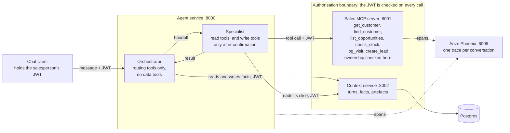

# field-sales-agent-reference

Personal study project with invented data. Not affiliated with any employer or client.

An AI assistant for field salespeople that looks up customers, opportunities and stock, and logs visits. It runs locally with mock data.

## What this shows

Six ideas that matter when an agent moves from prototype to production.

1. **Shared context between agents.** Each agent reads its own slice of one stored conversation (`orchestrator_slice` and `specialist_slice` in `services/context/context_service/slices.py`). Only the orchestrator can write facts, which are versioned (`orchestrator_only` in `api.py`).
2. **MCP tools that act as the user.** The token is checked on every call (`authenticate` in `services/mcp-sales/mcp_sales/auth.py`) and the owner of the data is checked inside the tool (`_own_customer` in `tools.py`). Write tools refuse without `confirmed`.
3. **Several agents, one harness, an allow-list.** The graph in `services/agent/agent_service/graph.py` has an orchestrator that only routes and a specialist limited to `READ_TOOLS` (`mcp_client.py`). `Harness` in `harness.py` limits steps, tool time and turn time.
4. **Traced by conversation.** Every span carries the conversation id as `session.id` (`set_session` in `services/agent/agent_service/telemetry.py`), so Phoenix groups the turns of one conversation. The MCP server records `business.visit_logged` and `business.lead_created` (`business_event` in its `telemetry.py`).
5. **An eval gate.** Rule-based cases in `evals/cases.yaml`, a runner with a threshold in `evals/run.py`, and an `eval` job in `.github/workflows/ci.yml`.
6. **Decisions written down.** Four ADRs in `docs/adr/`.

## Architecture



The salesperson's token travels with every call, and ownership of the data is checked inside the tools, not in a prompt: `get_customer` refuses a customer who belongs to someone else, and `find_customer` returns only the caller's own customers. The orchestrator can only route and never holds a data tool; the write tools run only after the salesperson has confirmed.

## Evals

There are 26 rule-based cases in five groups: lookup (5), stock (5), write with confirmation (6), out of scope (4) and security (6). Each case is a short conversation as one salesperson, and each turn states the tools the agent must or must not call and the text the answer must or must not contain. The gate is a pass rate of 85%.

Pass rates were between 96 and 100 in four runs of the active prompt pair, with one failure in 104 case runs. That failure was a 60 s timeout on a model call.

Locally, with the stack running and the `AZURE_OPENAI_*` values in `.env`:

```bash
uv run --project evals python evals/run.py            # all cases
uv run --project evals python evals/run.py --only security
```

It writes `evals/report.md`. In CI the `eval` job costs model calls, so it runs only on a pull request with the `run-evals` label, or by hand from the Actions tab. [A run on `main` in which the `eval` job passed](https://github.com/atiliosud/field-sales-agent-reference/actions/runs/38249014910).

## Development

You need Docker with Compose, Python 3.12 and [uv](https://docs.astral.sh/uv/).

### Run the stack

```bash
cp .env.example .env
docker compose up --build
```

| What | Where |
| --- | --- |
| Agent service | http://localhost:8000/health |
| Sales MCP server | http://localhost:8001/health (MCP at `/mcp`) |
| Context service | http://localhost:8002/health |
| Arize Phoenix | http://localhost:6006 |

### Lint

Ruff is pinned in CI; use the same version locally.

```bash
uvx ruff@0.16.8 check .                    # whole repository
uvx ruff@0.16.8 format --check .
uvx ruff@0.16.8 check services/agent       # one service
```

### Tests

Each service has its own environment. Run the tests from the service folder:

```bash
cd services/agent && uv run pytest         # one service
```

All services:

```bash
for s in services/*/; do (cd "$s" && uv run pytest) || exit 1; done
```

The mock data and the demo token script are tested from the repository root, with their own environment in `scripts/`:

```bash
uv run --project scripts pytest tests
```

### Demo token

Print a token for a salesperson (`sp-001` or `sp-002`). The script reads `JWT_SECRET` from the environment or from `.env`:

```bash
uv run --project scripts python scripts/make_token.py sp-001
```

### Chat client

With the stack running and the `AZURE_OPENAI_*` values in `.env`, chat as a salesperson. Type `yes` to confirm a pending action and `exit` to leave:

```bash
uv run --project scripts python scripts/chat.py --as sp-001
```

## How it was built

I designed this system and directed two AI coding agents to build it, acting
as the reviewing owner on every change. The interfaces were written before
the code (`docs/contracts.md`), every step went through a pull request I
reviewed and merged, and a rule-based eval set gated the behaviour I cared
about. Twenty-one pull requests over three days.

The method is part of the point. One eval failure turned out to be a data
leak through the orchestrator's system prompt rather than through any tool:
the prompt named a customer so the model could map a name to an id, and it
repeated that name when refusing a request from a salesperson who did not
own the record. The obvious fix was to edit the prompt, which would have
broken nine legitimate cases. The right fix was a new tool, `find_customer`,
with the ownership boundary inside it. I measured both prompt versions
against the same cases before switching.

The ADRs in `docs/adr/` were drafted against the code and are being
rewritten in my own words. "Not done yet" below is the honest list.

## Not done yet

- Voice through a realtime model, writing turns to the same context service.
- A web front end using AG-UI events.
- A model gateway (LiteLLM) to compare Microsoft Foundry and Amazon Bedrock with the same evals.
- Deployment on AWS ECS Fargate with Terraform.
- Real identity (Entra ID or Cognito) instead of local HS256 tokens.
- An idempotency key on `log_visit`, so that a repeated write does not log the visit twice.
- Validating the arguments of the pending action against the schema of the tool before asking for confirmation. Today the system can ask "Shall I go ahead?" for an action that will not run.
- Reading the payload of an artefact.
- Checking the context service against a real Postgres in CI instead of SQLite.
- Docker images that install from the lock files.
