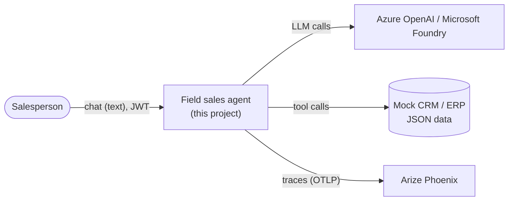
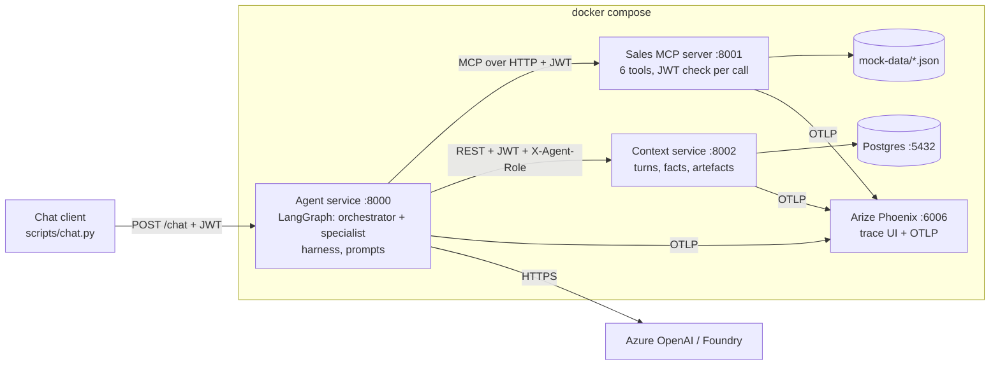
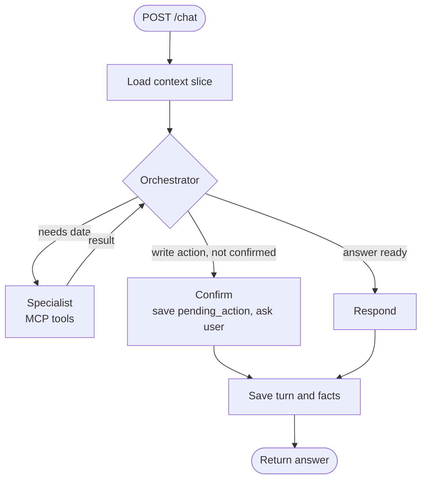
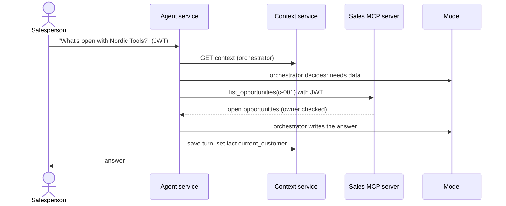
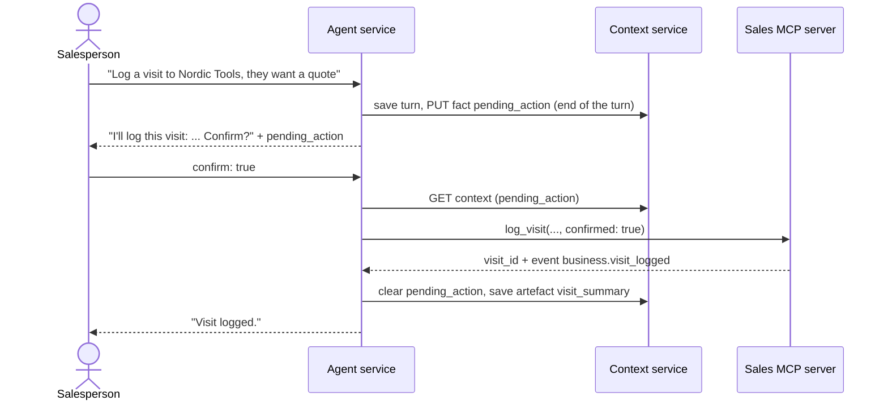
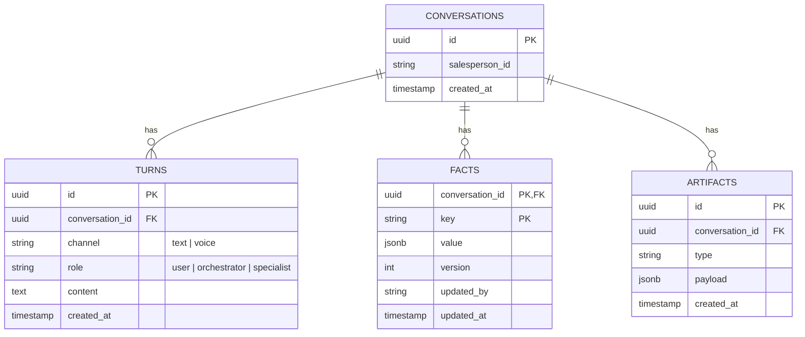
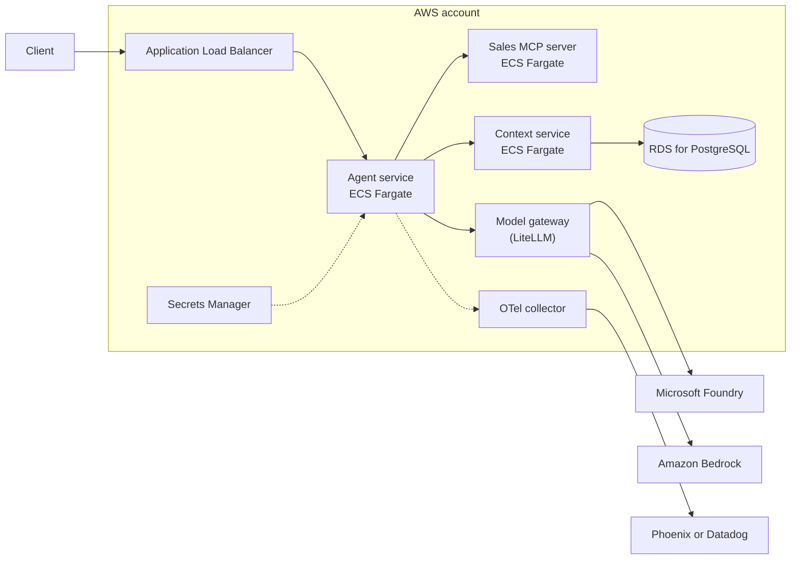

# Architecture

**Project:** field-sales-agent-reference · **Owner:** Atilio Moreira · **Version:** 1.0, October 2026

This is the architecture of the reference project: what it is for, how it is built, how the pieces talk to each other and why. It is written for the owner and for the two developers building it. The exact interfaces are in `docs/contracts.md`; the work split is in `docs/team-plan.md`.

Diagrams use Mermaid, which GitHub renders. The editable diagram is `docs/architecture.drawio`.

---

## 1. Purpose and scope

An AI assistant for field salespeople. A salesperson asks, in plain language, about their customers, open opportunities and stock, and asks the assistant to log a visit or create a lead. Everything runs locally with invented data.

The project exists to show, in working code, six architecture ideas that matter when an agent moves from prototype to production:

| # | Idea | Where it lives |
| --- | --- | --- |
| 1 | Shared context between agents and channels | Context service |
| 2 | Tools that act with the user's identity | Sales MCP server |
| 3 | Multi-agent work inside a harness with limits | Agent service |
| 4 | One trace per conversation, including business events | OpenTelemetry → Arize Phoenix |
| 5 | No evals, no release | `evals/` and CI |
| 6 | Decisions written down | ADRs and this document |

**In scope:** text chat through an API and a CLI, six sales tools, two agents, context storage, tracing, evals, CI, local deployment with Docker Compose.

**Out of scope (documented as next steps):** voice, a web front end, a model gateway with a second provider, cloud deployment, real identity. See section 12.

## 2. Quality goals

| # | Goal | What it means here | How it is met |
| --- | --- | --- | --- |
| 1 | **Security by design** | A salesperson only sees and changes their own data, whatever the model decides | Authorisation in the tools, not in the prompt; JWT on every call; write actions need confirmation |
| 2 | **Traceability** | Any answer can be explained after the fact | One trace per conversation; prompt version, tool calls, tokens and cost on spans |
| 3 | **Quality you can measure** | A change that makes answers worse does not ship | Eval set with a pass threshold in CI |
| 4 | **Predictable cost and latency** | An agent cannot loop or run forever | Harness limits on steps and time; token usage traced |
| 5 | **Explainable code** | The owner can walk through every file in an interview | Small services, one language, no extra frameworks |

## 3. Constraints

- Python 3.12 for all services; LangGraph for agents; FastAPI for HTTP; Postgres for storage.
- Runs on a laptop with `docker compose up`; no cloud resources needed except the model endpoint.
- Model: Azure OpenAI or Microsoft Foundry through environment variables, behind one factory function.
- Mock data only; no real company or client names anywhere.
- Public repository on the owner's GitHub; secrets never committed.

## 4. System context

- **Salesperson:** the only user role. Identified by a JWT with their id and region.
- **Model provider:** the only external dependency. Reached through one factory function, so a gateway or a second provider can be added without touching the agents.
- **Mock CRM/ERP:** JSON files that stand in for systems such as a CRM and an ERP. In a real setting these would be behind the same MCP tools.

## 5. Containers

| Container | Responsibility | Owns data | Built by |
| --- | --- | --- | --- |
| Agent service | Runs the conversation: routing, tool use through the specialist, confirmation flow, harness limits, prompt loading, chat API | None (stateless) | Dev B |
| Sales MCP server | Exposes sales data as six MCP tools; enforces who can see and change what | Mock data, visits and leads written at runtime | Dev A |
| Context service | Stores and serves conversation state per agent | Conversations, turns, facts, artefacts in Postgres | Dev A |
| Postgres | Storage for the context service | – | Dev A (schema) |
| Arize Phoenix | Collects and shows traces | Traces | Docker image |
| Chat client | Demo CLI that sends messages with a token | – | Dev B |

The agent service is stateless on purpose: all state lives in the context service, so a second channel (voice) or a second agent instance can join the same conversation.

## 6. Components

### 6.1 Agent service

| Component | Responsibility |
| --- | --- |
| `api` | `POST /chat`; reads the JWT and passes it down; returns answer, conversation id and any pending action |
| `graph` | The LangGraph state machine above |
| `orchestrator` | Owns the conversation. Decides the route, asks for confirmation before any write, and is the **only** writer of facts. Has no data tools |
| `specialist` | Sales data agent. Allow-list: the six MCP tools. Runs write tools only when the orchestrator passes `confirmed: true`. Returns results to the orchestrator, never to the user |
| `harness` | Wraps every turn: max 6 steps, 10 s per tool call, 60 s per turn (from config). When a limit hits, the agent says it could not finish and the span records which limit |
| `prompts` | Loads `prompts/<name>.<version>.yaml` by the versions set in config; puts `prompt.id` and `prompt.version` on model spans |
| `model_factory` | Creates the chat model from `AZURE_OPENAI_*`. The single place to change provider |
| `mcp_client` | Loads the tools with `langchain-mcp-adapters`, forwarding the user's JWT and `traceparent` |
| `context_client` | Calls the context service with the JWT and the right `X-Agent-Role` |

### 6.2 Sales MCP server

| Component | Responsibility |
| --- | --- |
| `server` | FastMCP over streamable HTTP at `/mcp` |
| `auth` | Validates the JWT on every call and returns the caller (`sub`, `region`). No token or a bad token is an error, never empty data |
| `tools` | `get_customer`, `find_customer`, `list_opportunities`, `check_stock` (read); `log_visit`, `create_lead` (write, need `confirmed: true`) |
| `repository` | Reads the mock JSON; writes visits and leads to a git-ignored runtime file |
| `telemetry` | Tool spans and business events (`business.visit_logged`, `business.lead_created`) |

Authorisation is decided here, by data ownership, not by the agent or the prompt. Even if the model is tricked into asking for another salesperson's customer, the tool refuses.

### 6.3 Context service

| Component | Responsibility |
| --- | --- |
| `api` | Endpoints in `docs/contracts.md` section 7 |
| `slices` | Builds the view each agent gets: the orchestrator sees the last 10 turns, all facts and artefacts; the specialist sees only `current_customer` and the task it was given |
| `facts` | Optimistic concurrency with `If-Match`; only `X-Agent-Role: orchestrator` may write |
| `access` | A salesperson can only read and write their own conversations |
| `db` | SQLAlchemy async models and Alembic migrations |

## 7. Runtime scenarios

### 7.1 Read question

1. The client sends the message with the salesperson's JWT.
2. The agent loads the orchestrator's context slice.
3. The orchestrator decides it needs data and hands off to the specialist.
4. The specialist calls `list_opportunities`; the MCP server checks that `c-001` belongs to the caller.
5. The orchestrator writes the answer, saves the turn and sets `current_customer`.

### 7.2 Write action with confirmation

1. The orchestrator recognises a write action and does **not** call the tool.
2. It returns a summary to the user. At the end of the turn, together with the turn, it saves `pending_action` as a fact. A pending question is only kept if the question was returned to the user, so a harness limit never leaves one behind. Any later turn that does not confirm it drops it.
3. On the next request with `confirm: true` (or a clear "yes"), the specialist calls `log_visit` with `confirmed: true`.
4. The MCP server records the visit and emits `business.visit_logged`.
5. The orchestrator clears the fact and stores a `visit_summary` artefact.

If the tool is ever called without `confirmed: true`, it returns `CONFIRMATION_REQUIRED`. The rule is enforced in two places on purpose.

### 7.3 Access to another salesperson's customer

1. `sp-001` asks about `c-006`, which belongs to `sp-002`.
2. The specialist calls `get_customer(c-006)` with `sp-001`'s token.
3. The MCP server returns `FORBIDDEN`.
4. The orchestrator tells the user the customer is not assigned to them. No data from `c-006` appears in the answer, the trace or the context.

### 7.4 Harness limit

1. A turn reaches 6 steps (a step is one model call), a tool call passes 10 s, or the turn passes 60 s. The 60 s include loading the context.
2. The harness stops the graph and clears any `pending_action`.
3. The user gets one of three messages, depending on what the turn had already written:
    - nothing written: "I couldn't finish this request; please try again or narrow it down."
    - a visit was logged before the limit: "The visit was logged, but I couldn't finish the rest of your request." This is not a failure.
    - a write was cut off and its result is unknown: "I'm not sure whether the visit was saved. Please check it before trying again."
4. The span records `harness.limit` (`max_steps`, `tool_timeout` or `turn_timeout`), `harness.steps_used`, and the status `ERROR` with the limit as description.
5. The turn is saved outside the limits, with a short fixed cap. If it cannot be saved, the answer is still returned and the span records it. If the context cannot be loaded, the turn fails with "I couldn't reach the conversation history; please try again."

## 8. Data

### 8.1 Context store (Postgres)

- **Turns** are what was said, on which channel and by whom. The `channel` column is what lets voice join the same conversation later.
- **Facts** are the shared working memory: small, keyed and versioned (`current_customer`, `pending_action`). Versioning stops two writers from overwriting each other.
- **Artefacts** are results worth keeping, such as a visit summary.

### 8.2 Mock sales data

Two salespeople (`sp-001` North, `sp-002` South), ten customers (five each), about fifteen opportunities and twenty product lines. Identifiers are fixed in `docs/contracts.md` section 4 so tests, evals and the demo all use the same ones.

## 9. Cross-cutting concepts

### 9.1 Identity and authorisation

- One JWT per salesperson (HS256, demo only) with `sub`, `name`, `region`.
- The token travels with every hop: client → agent → MCP server and context service. The agent never acts with its own identity.
- Authorisation is enforced by the services that own the data. The model and prompts are never trusted to enforce it.

### 9.2 Agent design rules

- One orchestrator owns the conversation; the specialist does focused work and reports back.
- Each agent gets only the context it needs (context slices), which keeps prompts smaller, cheaper and easier to reason about.
- Only the orchestrator writes shared facts.
- Write actions always need explicit user confirmation.
- Every turn runs inside the harness limits.

### 9.3 Observability

- OpenTelemetry in all three services, exported over OTLP to Phoenix; W3C `traceparent` propagated so one turn is one trace across services.
- `session.id` (conversation) and `user.id` (salesperson) on every span; `prompt.id` and `prompt.version` on model spans; `tool.name` and `customer.id` on tool spans.
- Model calls, tokens and cost through OpenInference instrumentation.
- Business events (`business.visit_logged`, `business.lead_created`) on tool spans, so usage can be tied to sales activity.
- Never in spans or logs: tokens, contact details, free-text notes.

### 9.4 Prompts

- Prompts live in `prompts/` as versioned YAML, not in code.
- Active versions come from config; changing a prompt means a new file and a config change, reviewed in a PR and checked by evals.

### 9.5 Quality and evals

- About 25 cases in five groups: lookup, stock, write with confirmation, out of scope, security.
- Rule-based checks (expected tool calls and answer content), so results are repeatable without an LLM judge.
- Pass rate below 85% fails the job. Runs on pull requests labelled `run-evals` or on demand, to control cost.
- Unit and integration tests run on every push, using a fake model.

### 9.6 Errors

- One error format across services (`docs/contracts.md` section 5).
- The agent turns tool errors into plain answers: `FORBIDDEN` becomes "not assigned to you", `NOT_FOUND` becomes "I couldn't find it".

### 9.7 Configuration and secrets

- All configuration through environment variables listed in `.env.example`.
- `.env` is git-ignored. CI reads the model key from GitHub secrets.

## 10. Deployment

### 10.1 Built: local

`docker compose up` starts Postgres, Phoenix and the three services on one machine. The model endpoint is the only external call.

### 10.2 Next step: AWS (documented, not built)

Provisioned with Terraform. Containers on ECS Fargate, Postgres on RDS, secrets in Secrets Manager, traces through an OpenTelemetry collector. The model gateway lets the same evals compare Foundry and Bedrock on quality, latency and cost before choosing.

## 11. Architecture decisions

| ADR | Decision | Main reason |
| --- | --- | --- |
| [0001](adr/0001-shared-context-service.md) | A shared context service per conversation instead of passing full history between agents | Agents get only what they need; voice and text share one conversation; state outlives a process |
| [0002](adr/0002-mcp-tools-with-user-identity.md) | MCP tools that act with the user's identity, with an allow-list per agent | Authorisation stays in the data owner, not in the prompt |
| [0003](adr/0003-eval-gate-in-ci.md) | Rule-based eval gate in CI | Quality changes are caught before merge, repeatably and cheaply |
| [0004](adr/0004-model-behind-a-factory.md) | Model behind one factory function | Provider can change (gateway, Bedrock) without touching agents |

## 12. Risks, limitations and next steps

| Item | Today | Next step |
| --- | --- | --- |
| Identity | Local HS256 tokens | Entra ID or Cognito, with token exchange to tools |
| Channels | Text only | Voice through a realtime model, writing turns to the same context service |
| Front end | CLI | Web app using AG-UI events |
| Model provider | One endpoint | Gateway comparing Foundry and Bedrock with the same evals |
| Evals | Rule-based, ~25 cases | Larger set from real questions; human review of failures |
| Runtime data | Visits and leads in a local file | Written to the real systems through the same tools |
| Deployment | Docker Compose | ECS Fargate with Terraform |
| Guardrails | Scope rules in prompts, confirmation, authorisation in tools | Content safety service and policy checks on outputs |

## 13. Glossary

| Term | Meaning |
| --- | --- |
| ADR | Architecture Decision Record: a short note of a decision, the options and why |
| Artefact | A stored result of a conversation, such as a visit summary |
| Context slice | The part of the conversation state a given agent is allowed to see |
| Fact | A small, versioned piece of shared state, such as the current customer |
| Harness | The code around the model that sets instructions, tools and limits |
| MCP | Model Context Protocol: a standard way for agents to call tools |
| Orchestrator | The agent that owns the conversation and coordinates others |
| Specialist | An agent with one job and a fixed set of tools |
| Span / trace | One step / the whole tree of steps for a request, in OpenTelemetry |
